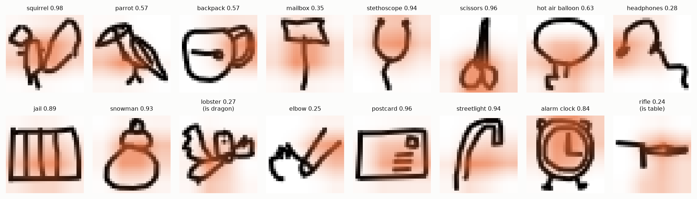
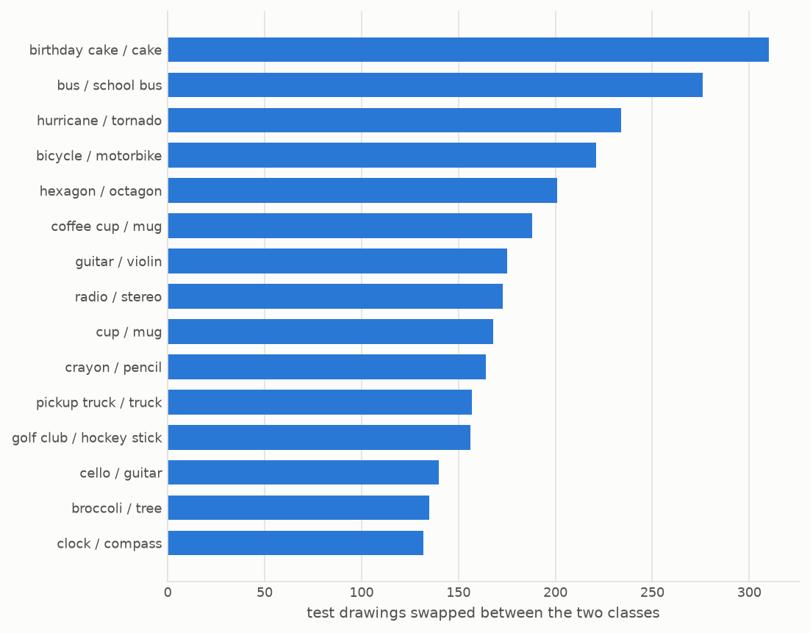
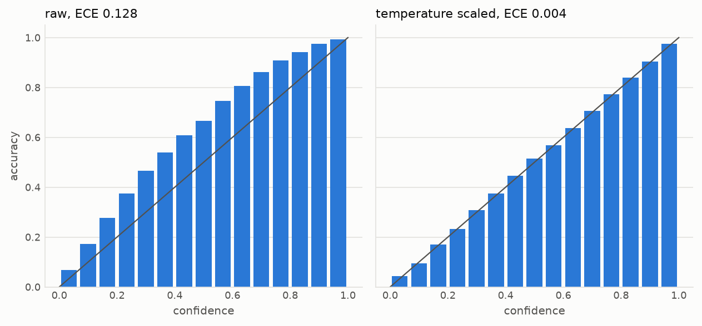
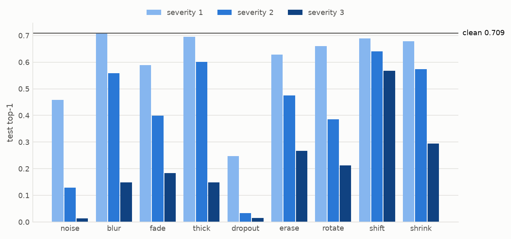
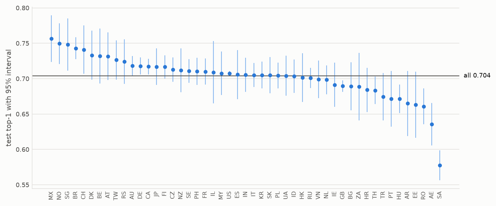
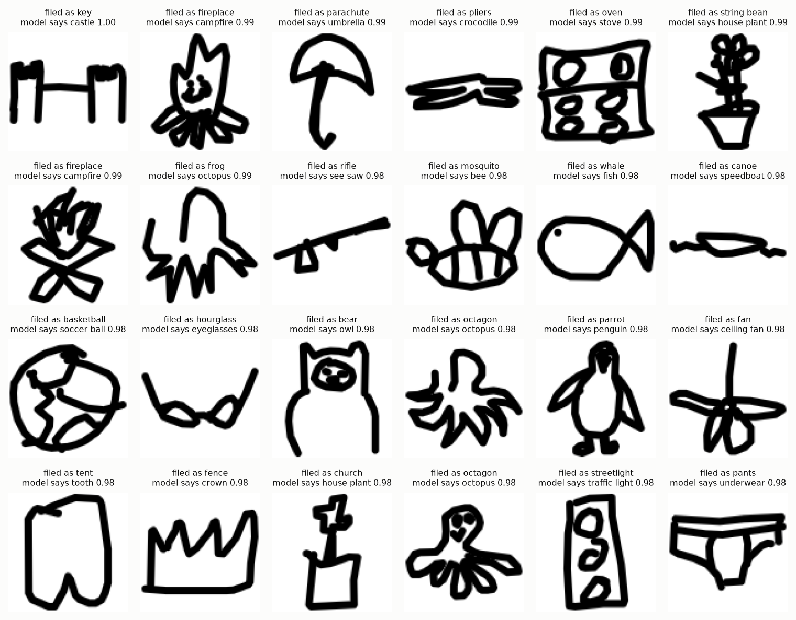

# cnn-image-classifier-on-hadoop

A doodle classifier where Hadoop does the data work and a CNN I wrote from scratch does the guessing.

The drawings come from Google's Quick, Draw! game. I load 21 million of them into HDFS, MapReduce jobs on YARN clean them up and turn them into small images, and a ResNet trains on those images straight out of HDFS. After training, the model goes back to the cluster inside one more MapReduce job that scores drawings it has never seen.

Everything ran on my laptop, an HP OmniBook 5 with an Intel Core 5 120U and 8 GB of RAM. Hadoop 3.5.0 runs as a single node inside WSL, and all the training is on the CPU.

Live demo: [huggingface.co/spaces/adwitiyashukla/cnn-image-classifier-on-hadoop](https://huggingface.co/spaces/adwitiyashukla/cnn-image-classifier-on-hadoop). Draw something and the model guesses what it is after every stroke. It runs in your browser, so nothing you draw is uploaded.

## Results

The model picks one of 345 words for each drawing. I tested it on 171,874 drawings that were kept out of training, about 500 per word.

| metric | score | 95% interval |
|---|---|---|
| top-1 accuracy | 0.7040 | 0.7017 to 0.7062 |
| top-3 accuracy | 0.8639 | 0.8623 to 0.8656 |
| MAP@3 | 0.7767 | 0.7750 to 0.7784 |

Top-3 means the right word is among the model's first three guesses. MAP@3 is the score Kaggle used in its Quick, Draw! competition. It gives full credit when the first guess is right, half when the second one is and a third when the third one is. Guessing at random would get 0.003 top-1.

The model is a ResNet with 1.61 million weights. It saw each of the 1,377,811 training drawings exactly once. That one pass took 98 minutes on 6 CPU threads, which is 234 drawings per second.



These are the first 16 test drawings with the model's guess and how sure it was. The orange wash is the class activation map. It marks the part of the drawing that pushed the model toward that guess.

To check that the maps mean something, I took 2,048 test drawings and erased the hottest cell of each 4x4 map, which removes 10% of the ink. The model's confidence in the right word fell from 0.514 to 0.350. Erasing one random cell that has ink in it (9% of the ink) only brought it down to 0.404.

### Where it goes wrong

34 of the 345 words are right less than half of the time. The hardest are garden hose (0.18), marker (0.23), aircraft carrier (0.24) and bear (0.24). The easiest are The Eiffel Tower (0.94), envelope (0.93), ladder (0.93) and triangle (0.93).

The pairs it swaps most often are words that mean almost the same thing or look alike on paper, like birthday cake and cake, bus and school bus, or hurricane and tornado.



The game also saved whether Google's model recognized each drawing while it was being drawn. My model gets 0.7505 on the 157,859 recognized test drawings and 0.1800 on the 14,015 that were not recognized. The drawings that Google's model could not recognize are hard for mine too.

### Does the stroke order help?

A drawing in this dataset is a list of strokes in the order they were drawn, and a plain black and white image throws that order away. So each drawing becomes three planes. The first is the ink, the second is the ink shaded by which stroke it belongs to, and the third is the ink shaded by how far along the drawing it is.

To see if the two extra planes are worth it, I trained the same ResNet twice on one eighth of the training data (172,226 drawings, one pass), once with all three planes and once with the ink alone. These are the scores on the 86,793 validation drawings.

| input | top-1 | top-3 | MAP@3 |
|---|---|---|---|
| ink only | 0.4605 | 0.6629 | 0.5505 |
| ink, stroke order and progress | 0.4822 | 0.6877 | 0.5734 |

The two extra planes are worth 0.022 of top-1, a bit more than 2 points. Both scores are far below the main model because these runs only saw one eighth of the data. I trained each one once with the same seed, so the size of the gap could move a little in another run.

### Confidence

When the model says it is 80 percent sure, it should be right about 80 percent of the time. The expected calibration error measures how far off that is, and for the raw outputs it is 0.128. The model is less sure than it should be, and the label smoothing used in training is the likely reason. Dividing the logits by a temperature of 0.77, fitted on the validation set, brings the error down to 0.004.



### Messy drawings

I changed 5,000 test drawings in nine ways at three strengths each and tested the model on every version. On the clean drawings it scores 0.709. Averaged over all 27 versions it scores 0.408. Small changes cost little, like a 3 pixel shift (0.689), slightly thicker lines (0.696) or a light blur (0.711). A 15 degree turn costs about 5 points (0.661). Pixel noise and missing pixels are the worst. With a quarter of the pixels dropped it is down to 0.033. Real drawings never look like that, so the model has never seen anything close.



### Countries

The drawings come from 215 countries, and 45% of them are from the United States. 49 countries have at least 300 drawings in the test set. Their accuracy goes from 0.577 (Saudi Arabia) to 0.757 (Mexico). Most countries land within a few points of the overall score.



## The Hadoop pipeline

The raw data is 345 files of newline-delimited JSON, one file per word. Each line is one drawing with its strokes, the country it came from and a flag that says whether Google's model recognized it during the game. The full set has about 50 million drawings. I took the first 26 MB of every file so it would fit on my laptop next to everything else, which comes to 21,080,792 drawings and 9.40 GB. Setting `source.max_mb = 0` takes all of it.

| step | how it runs | what it does | time on my laptop |
|---|---|---|---|
| ingest | 4 threads | streams the files from Google's bucket into HDFS through WebHDFS | 9 min 57 s |
| profile | MapReduce, 35 map and 8 reduce tasks | counts drawings, strokes and points per word and per country | 8 min 29 s |
| audit | MapReduce, 35 map and 8 reduce tasks | finds drawings that have exactly the same strokes | 12 min 29 s |
| build | MapReduce, 35 map and 32 reduce tasks | picks the train, validation and test drawings, draws each one as an image and shuffles them into shard files | 30 min 20 s |
| score | MapReduce, 35 map and 8 reduce tasks | runs the trained model on drawings that are in no split | 18 min 54 s |

Some things the jobs turned up:

- Google's model recognized 92.2% of the drawings while they were being drawn. That goes from 81.0% for stove to 98.8% for rainbow.
- The average drawing has 4.9 strokes and 41 points. A hedgehog takes 14.0 strokes on average and a circle 1.3.
- The audit found 2,448 groups of exact copies inside one word and 956 groups where the same strokes are filed under different words. The biggest group is one straight line that shows up 625 times. 608 of those are filed under line and the other 17 under 16 other words like hexagon, bathtub and toothbrush. In total the audit drops 14,684 drawings, and 11,525 of them are from the line class.
- The build job keeps 1,636,478 drawings. 1,377,811 are for training, 86,793 for validation and 171,874 for testing. They end up in 96 shard files that take 2.15 GB in HDFS.

### Finding bad labels with the model

`python -m imgcnn score` sends the trained model back to the cluster. The ONNX file travels to the mappers through the distributed cache. Each mapper skips the drawings that are in one of the splits or were dropped by the audit, picks 2% of the rest by hashing the drawing id, draws them and runs the model with ONNX Runtime.

That scored 388,223 drawings the model had never seen. It got 0.7074 top-1 on them, or 0.7026 when every word counts the same. That is a second test set that the training code never touched, and it agrees with the test score above.

The job also flags a drawing when the model is at least 90% sure of a different word than the label. That happens for 0.17% of the recognized drawings and 0.70% of the unrecognized ones. Below are the 24 it was most sure about. In most of them the model looks right and the label looks wrong. Some players seem to have misread the word, like the eyeglasses filed under hourglass and the two octopuses filed under octagon.



## Speed

`python -m imgcnn bench` times one training step for each of the three CNN families in `imgcnn/models.py` on random data, with batches of 128 drawings and 6 threads. It warms the CPU up first and takes the median of 3 rounds, because a laptop CPU slows down a lot once it gets hot.

| model | weights | multiply-adds per drawing | drawings per second in training |
|---|---|---|---|
| ResNet | 1.61M | 83M | 231 |
| MobileNet | 1.34M | 30M | 187 |
| ConvNeXt | 1.59M | 43M | 189 |

The ResNet does the most multiply-adds and is still the fastest to train. MobileNet needs about a third as many and ConvNeXt about half, so counting multiply-adds does not tell you the speed on a CPU. The memory layout matters too. The same ResNet trains at 208 drawings per second with channels-first tensors and at 231 with channels-last, which is what the training code uses.

More threads do not make it faster. With all 12 logical cores the ResNet drops to 118 drawings per second, so I train with 6.

`python -m imgcnn export` writes the model as an ONNX file and as an int8 version, quantized with 2,048 validation drawings. All three are scored on the full test set.

| format | file size | test top-1 | one drawing, one thread | drawings per second, batched |
|---|---|---|---|---|
| PyTorch | 6.48 MB | 0.7040 | 3.56 ms | 521 |
| ONNX | 6.51 MB | 0.7040 | 2.14 ms | 705 |
| ONNX int8 | 1.65 MB | 0.7034 | 0.77 ms | 1,588 |

The ONNX output matches PyTorch to within 5.7e-06. The int8 file is a quarter of the size and the fastest of the three, and it costs 0.0006 of top-1.

## The same kind of CNN in plain NumPy

`imgcnn/scratch.py` is a small CNN where I wrote every forward and backward pass by hand in NumPy. That covers convolution, batch norm, ReLU, max pooling, global average pooling, softmax cross-entropy and SGD with momentum. `python -m imgcnn scratch` checks it against PyTorch.

- In float64, the gradient from my backward pass and the one from PyTorch autograd differ by a relative error of 7.3e-15 on one batch.
- Both versions then train in float32 from the same weights on the same batches, 15,000 drawings from 10 words for 4 epochs. The loss after each epoch is 1.3122, 0.7515, 0.6116, 0.5316 in NumPy and 1.3112, 0.7476, 0.6069, 0.5287 in PyTorch. On 3,000 test drawings NumPy gets 0.7407 and PyTorch 0.7757.
- The two runs are close and not identical because float32 rounding is different in my matrix-product convolution and in PyTorch's, and the small differences grow as training goes on. In float64 the tests train both for a few steps and the losses agree to 9 decimal places.

## How it works

### Getting the data into HDFS

`python -m imgcnn ingest` reads the file list from Google's bucket and copies the files with four threads. Each download goes straight into a WebHDFS upload, so nothing is written to the local disk on the way. A file lands in a staging folder first and is renamed into `/imgcnn/raw` only when it is complete. If I take whole files, the MD5 from the bucket is checked too. Running the command again skips the files that are already there.

I wrote the WebHDFS client myself in `imgcnn/hdfs.py` on top of `requests`. The training code uses the same client to read the shards.

### The MapReduce jobs

The jobs are Hadoop Streaming jobs. The mappers and reducers are plain Python functions in `imgcnn/mr.py`, and the driver in `imgcnn/jobs.py` zips the code, ships it to the nodes through the distributed cache and reads the job counters back when the job is done.

- profile adds up its counts inside the mapper and only emits totals at the end. The mappers read 21,080,792 lines and send only 12,925 records to the reducers.
- audit hashes the strokes of every drawing and uses the hash as the key, so all copies of a drawing meet in the same reducer. If most of a group agrees on one word, the reducer keeps one copy with that word and drops the rest. If there is no majority, the whole group goes.
- build decides the split by hashing the drawing id. No state is needed for that, so every mapper makes the same choice for the same drawing, and a drawing can never end up in two splits. The class quotas come from the profile counts. The mapper draws the image and emits it under a second hash as the sort key, which means the MapReduce shuffle does the global shuffle of the training data for free. A small Java output format (the only Java in the repo) writes the reducers' output into `train`, `val` and `test` folders.
- score ships the ONNX model to the mappers through the distributed cache and runs it with ONNX Runtime. More on that above.

### From strokes to an image

A drawing is a list of strokes, and a stroke is a list of points in the order they were drawn. `imgcnn/raster.py` turns that into three 32x32 planes with anti-aliased lines. It only uses the Python standard library, so it runs inside a mapper without installing anything.

1. the ink
2. the ink shaded by which stroke it belongs to, so the first stroke is the brightest
3. the ink shaded by how far along the whole drawing it is

The three planes are compressed and stored as one text line per drawing together with the label, the drawing id, the country and the recognized flag.

### The models

`imgcnn/models.py` has three CNN families written with plain PyTorch layers. The first is a pre-activation ResNet. The second is a MobileNetV2 style network with squeeze-and-excitation. The third is a ConvNeXt style network with its own LayerNorm, layer scale and stochastic depth. All three end in global average pooling and one linear layer. That makes the class activation maps cheap, because they are just the last feature map multiplied by the weights of that linear layer. The export writes them as a second output of the ONNX file, which is what the demo draws.

The ResNet is the one I trained, because it is the fastest of the three on a CPU.

### Training

`imgcnn/train.py` streams the shards from HDFS in a loader process and mixes them through a shuffle buffer. The rest is AdamW with a warm-up and a cosine learning rate, label smoothing, small random rotations, shifts, zooms and flips done on the whole batch at once, gradient clipping and an exponential moving average of the weights. The averaged weights are the ones that get tested and exported.

A checkpoint is saved every 500 steps. If the run is killed, the same command picks up from the last checkpoint. I needed that on a laptop.

The same command also trains with several processes. `torchrun --nproc_per_node=2 -m imgcnn train` starts two workers that each read their own shards and sync gradients with PyTorch's DistributedDataParallel. The CI run trains a model this way on every push.

### Testing the model

`python -m imgcnn evaluate` reads the test shards from HDFS and computes everything in the results section. That means the scores with bootstrap intervals, the accuracy per word and per country, the confused pairs, the calibration, the changed drawings and the class activation maps.

### The demo

The demo is a static page. `space/doodle.js` is a JavaScript copy of the rasterizer, and the page runs the exported ONNX file with ONNX Runtime Web. The tests run both rasterizers on 204 drawings at two sizes and compare the pixels. I also checked the whole page in headless Chromium against Python. On 40 random drawings it gave the same pixels and the same top guess as Python, and the logits were within 3e-06.

## Running it

You need Linux or WSL, Python 3.12, Java 17 and an unpacked [Hadoop 3.5.0](https://hadoop.apache.org/releases.html).

```
git clone https://github.com/adwitiyashukla/cnn-image-classifier-on-hadoop
cd cnn-image-classifier-on-hadoop
python3 -m venv .venv
source .venv/bin/activate
pip install -r requirements.txt
export HADOOP_HOME=~/hadoop-3.5.0
bash hadoop/setup.sh install
bash hadoop/setup.sh start
```

`setup.sh install` writes a single-node config, formats HDFS and compiles the Java class. `setup.sh start` brings up HDFS, YARN and the job history server. On my 8 GB laptop I gave YARN less memory with `export IMGCNN_NM_MB=2560` before the install.

Then the pipeline:

```
python -m imgcnn ingest
python -m imgcnn profile
python -m imgcnn audit
python -m imgcnn build
bash experiments.sh
```

`experiments.sh` trains the main model, tests it, exports it, runs the scoring job and the NumPy check, trains the two small models for the stroke order comparison, prints a table of all runs and writes the figures to `runs/report`. The first table in the speed section comes from `python -m imgcnn bench`.

Every setting is in `config.toml` and is checked when it loads. Any of them can be changed for one run from the command line:

```
python -m imgcnn train --name longer --set train.epochs=3
```

To open the demo on your own machine after the export:

```
python -m imgcnn space
python -m http.server 8000 -d runs/space
```

## Tests

`pytest` runs 145 tests. They check the rasterizer, the mappers and reducers on small inputs, the WebHDFS client against canned replies, the three models, a resumed training run against one that never stopped, two training processes against one, the metrics, the ONNX export against PyTorch, the NumPy gradients against autograd, and the JavaScript rasterizer against the Python one. The JavaScript tests need Node and are skipped when it is not installed.

GitHub Actions also runs the real thing on every push. It starts HDFS and YARN on the runner, ingests 8 words, runs all the MapReduce jobs, trains and tests a model, runs the scoring job on YARN, trains with two processes and builds the report.

## Layout

| file | what is in it |
|---|---|
| `imgcnn/ingest.py` | bucket to HDFS copy |
| `imgcnn/hdfs.py` | WebHDFS client |
| `imgcnn/mr.py` | mappers and reducers |
| `imgcnn/jobs.py` | Hadoop Streaming driver and job summaries |
| `imgcnn/raster.py` | strokes to image planes |
| `imgcnn/data.py` | shard streaming for training |
| `imgcnn/models.py` | ResNet, MobileNet and ConvNeXt |
| `imgcnn/train.py` | training loop, checkpoints, benchmark |
| `imgcnn/evaluate.py` | test metrics, changed drawings, class activation maps |
| `imgcnn/metrics.py` | ranks, calibration, bootstrap |
| `imgcnn/export.py` | ONNX, int8 and the Space folder |
| `imgcnn/scratch.py` | the NumPy CNN |
| `imgcnn/plots.py`, `imgcnn/report.py` | figures and the run table |
| `imgcnn/config.py` | config checks |
| `imgcnn/__main__.py` | the command line |
| `hadoop/` | single-node setup script, config templates, the Java output format |
| `space/` | the demo page |
| `tests/` | tests |

## Credits

- The drawings are from the [Quick, Draw! dataset](https://github.com/googlecreativelab/quickdraw-dataset) by Google Creative Lab, shared under CC BY 4.0. None of the data is in this repo. `python -m imgcnn ingest` downloads it.
- ResNet: He et al., "Identity Mappings in Deep Residual Networks", 2016.
- MobileNetV2: Sandler et al., 2018. Squeeze-and-excitation: Hu et al., 2018.
- ConvNeXt: Liu et al., "A ConvNet for the 2020s", 2022.
- Class activation maps: Zhou et al., 2016. Grad-CAM: Selvaraju et al., 2017.

MIT license.
